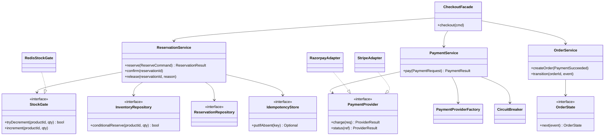

# Class Diagram (Inventory, Payment, Order)

## Where validation, idempotency and error handling live

- **Validation:** API Gateway (schema, auth) and service entry points (sale active, per-user limit).
- **Idempotency:** Reservation (idempotency key + UNIQUE constraint), Payment (key + `payment_ref`), Order consumer (UNIQUE `reservation_id`).
- **Error handling:** domain exceptions mapped to HTTP codes at controllers; retries and DLQ at message consumers.
