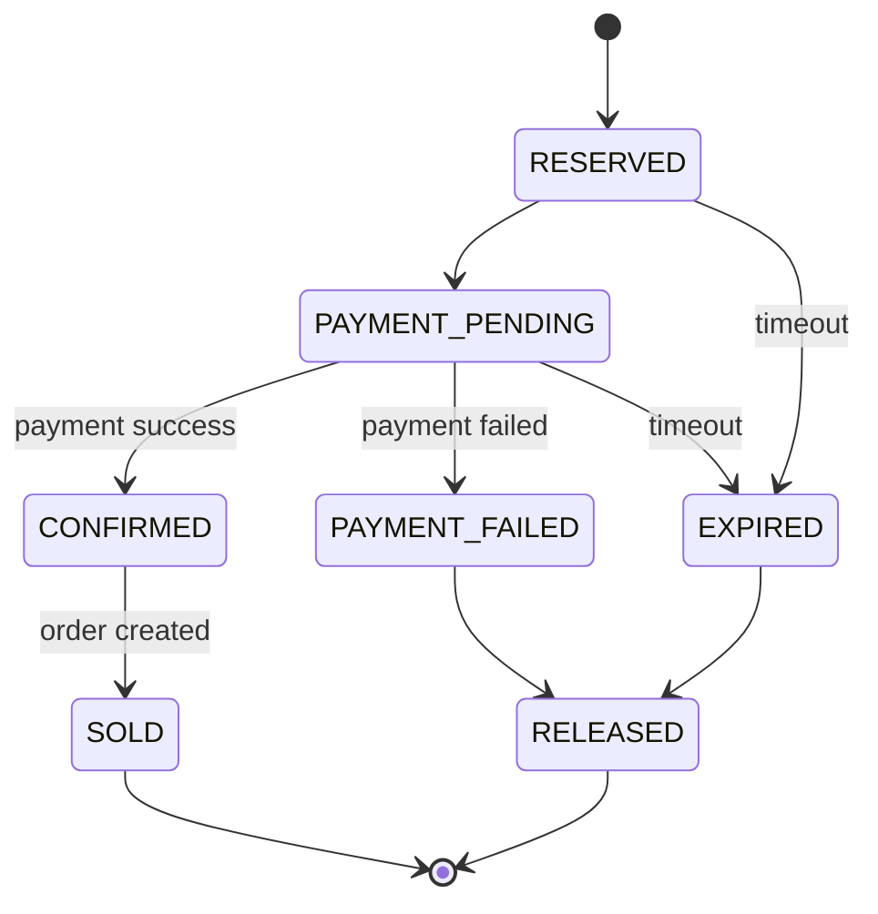
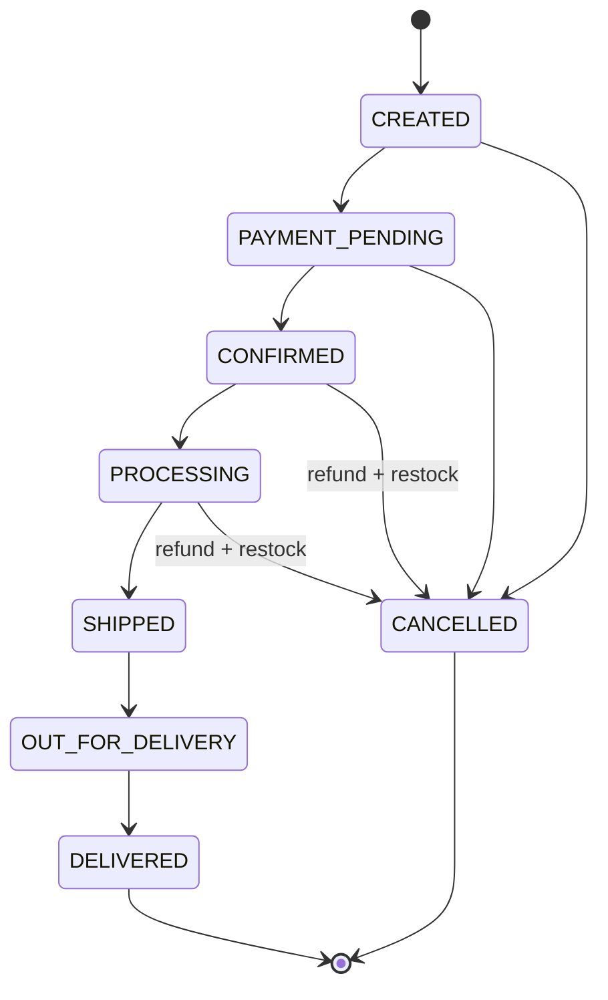

# State Diagrams

## Reservation lifecycle

| Transition | Trigger | Effect on inventory |
|---|---|---|
| create -> RESERVED | Buy Now wins gate | available -1, reserved +1 |
| RESERVED -> PAYMENT_PENDING | Checkout starts | no change |
| PAYMENT_PENDING -> CONFIRMED | Payment success event | no change yet |
| CONFIRMED -> SOLD | Order created | reserved -1, sold +1 |
| -> RELEASED | Payment failed / expired | reserved -1, available +1, Redis stock +1 |

## Order lifecycle

Only valid transitions are allowed (State pattern). Any other transition throws `IllegalStateTransition` and is audited.
