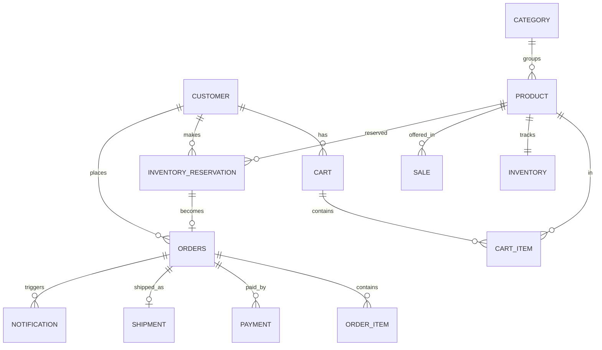

# Database Design

## Entities and keys

| Table | PK | FKs | Constraints / indexes |
|---|---|---|---|
| CUSTOMER | customer_id | - | UNIQUE(email) |
| CATEGORY | category_id | - | - |
| PRODUCT | product_id | category_id | INDEX(category_id) |
| SALE / DEAL / COUPON | sale_id | product_id | INDEX(product_id, start_time) |
| INVENTORY | inventory_id | product_id | UNIQUE(product_id), CHECK(available_quantity >= 0), version |
| INVENTORY_RESERVATION | reservation_id | product_id, customer_id | UNIQUE(idempotency_key), INDEX(status, expires_at), UNIQUE(customer_id, sale_id) |
| CART / CART_ITEM | cart_id / item_id | customer_id, product_id | INDEX(customer_id) |
| ORDERS | order_id | customer_id, reservation_id | UNIQUE(reservation_id) |
| ORDER_ITEM | order_item_id | order_id, product_id | INDEX(order_id) |
| PAYMENT | payment_id | order_id / reservation_id | UNIQUE(idempotency_key), UNIQUE(gateway_txn_ref) |
| SHIPMENT | shipment_id | order_id | INDEX(order_id, status) |
| NOTIFICATION | notification_id | customer_id, order_id | INDEX(status) |
| OUTBOX_EVENT | event_id | - | INDEX(published, created_at) |
| AUDIT_LOG | log_id | - | append-only, INDEX(entity_id, created_at) |

## Relationships

## Transaction boundaries

- **Reserve:** inventory update + reservation insert + outbox event = one transaction.
- **Confirm payment:** payment row + reservation status + outbox event = one transaction.
- **Order creation:** order row + reservation SOLD + inventory sold update (each service owns its own transaction, linked by events).
- Cross-service steps use events, not distributed transactions.

## SQL vs NoSQL

SQL (PostgreSQL/MySQL) for inventory, reservation, payment and order because ACID, constraints and audit matter. Redis/NoSQL for cart, sessions, cache, rate limiting and idempotency lookups where speed matters more than relations.

## Prompt to generate the ER diagram in dbdiagram.io

Ask an AI tool: "Generate DBML for the tables above with PKs, FKs, UNIQUE keys, indexes and CHECK constraints (available_quantity >= 0 and available + reserved + sold = total), grouped as Catalogue, Inventory, Order & Payment, Fulfilment, System." Paste the output into dbdiagram.io and export PNG/PDF.
